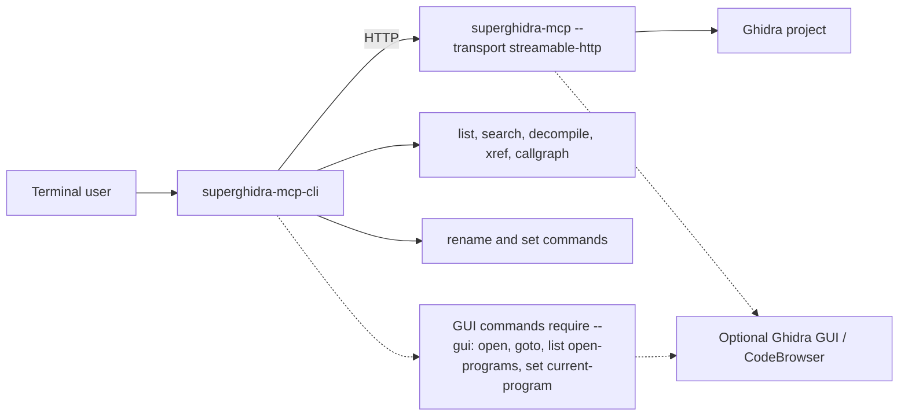

# SuperGhidra MCP CLI

A command-line client for the superghidra-mcp server, providing a user-friendly interface to interact with Ghidra binary analysis.

## Installation

Install from the repository source:

```bash
cd cli
pip install -e .
```

Or using `uv`:

```bash
cd cli
uv pip install -e .
```

## Why HTTP Only?

This CLI connects to superghidra-mcp **exclusively via HTTP** for the following reasons:

- **No startup overhead**: STDIO mode would spawn a new Java/Ghidra process for each CLI invocation, causing significant delays (10-60 seconds per command)
- **Better lifecycle management**: HTTP server stays running, allowing multiple CLI commands without repeated initialization
- **Clearer error handling**: Connection failures are distinct from Ghidra initialization errors
- **Resource efficiency**: One Ghidra instance serves multiple CLI calls
- **Simpler architecture**: CLI is purely a client, server handles all Ghidra lifecycle management

## Setup Diagram



## Quick Start

### 1. Start the Server

First, start the superghidra-mcp server in a separate terminal:

```bash
# Option A: Open existing Ghidra project
superghidra-mcp --transport streamable-http --project-path /path/to/project.gpr

# Option B: Import and analyze a binary
superghidra-mcp --transport streamable-http --wait-for-analysis /bin/ls

# Option C: Import multiple binaries
superghidra-mcp --transport streamable-http --wait-for-analysis ./binary1 ./binary2
```

### 2. Use the CLI

Once the server is running, use the CLI to interact with it:

```bash
# List available binaries
superghidra-mcp-cli list binaries

# Decompile a function
superghidra-mcp-cli decompile --binary my_binary.dylib main

# Search for symbols
superghidra-mcp-cli search symbols --binary my_binary.so malloc -l 20
```

## Commands

```bash
superghidra-mcp-cli [OPTIONS] COMMAND [ARGS...]

Options:
  --host TEXT              Server host (default: 127.0.0.1)
  --port INTEGER           Server port (default: 8000)
  -v, --verbose            Verbose output
  -f, --format             Output: json|table|text (default: text)

Commands:
  decompile    Decompile a function
  search       Search symbols, code, strings
  list         List binaries, imports, exports, GUI programs
  rename       Rename functions and variables
  set          Set types, prototypes, and comments
  open         Open GUI resources
  goto         Navigate the Ghidra GUI
  xref         List cross-references
  read         Read memory bytes
  callgraph    Generate call graphs
  import       Import a binary
  delete       Delete a binary
  metadata     Show binary metadata
  fork         List, merge, or discard forks of a shared project
```

## Command Reference

### decompile

Decompile a function in a binary.

```bash
superghidra-mcp-cli decompile --binary <binary_name> <function_name_or_address>
```

### search

Search within binaries.

**Search for symbols:**
```bash
superghidra-mcp-cli search symbols --binary <binary_name> <query> [options]

Options:
  -o, --offset INTEGER    Offset for pagination (default: 0)
  -l, --limit INTEGER     Maximum results (default: 25)
```

**Search for code patterns:**
```bash
superghidra-mcp-cli search code --binary <binary_name> <query> [options]

Options:
  -l, --limit INTEGER           Maximum results (default: 5)
  -o, --offset INTEGER          Offset for pagination (default: 0)
  -m, --mode [semantic|literal] Search mode (default: semantic)
  --full-code / --preview       Show full code or preview only
  -p, --preview-length INTEGER  Preview length in chars (default: 500)
  -t, --similarity-threshold FLOAT  Minimum similarity 0.0-1.0 (default: 0.0)
```

**Search for strings:**
```bash
superghidra-mcp-cli search strings --binary <binary_name> <query> [options]

Options:
  -l, --limit INTEGER     Maximum results (default: 100)
```

### list

List information about binaries.

**List all binaries:**
```bash
superghidra-mcp-cli list binaries
```

**List GUI-open programs (`--gui` server only):**
```bash
superghidra-mcp-cli list open-programs
```

**List imports:**
```bash
superghidra-mcp-cli list imports --binary <binary_name> [options]

Options:
  -q, --query TEXT        Filter by regex pattern (default: .*)
  -o, --offset INTEGER    Offset for pagination (default: 0)
  -l, --limit INTEGER     Maximum results (default: 25)
```

**List exports:**
```bash
superghidra-mcp-cli list exports --binary <binary_name> [options]

Options:
  -q, --query TEXT        Filter by regex pattern (default: .*)
  -o, --offset INTEGER    Offset for pagination (default: 0)
  -l, --limit INTEGER     Maximum results (default: 25)
```

### xref

List cross-references to a symbol or address.

```bash
superghidra-mcp-cli xref --binary <binary_name> <name_or_address>
```

### read

Read bytes from memory at an address.

```bash
superghidra-mcp-cli read --binary <binary_name> <address> [options]

Options:
  -s, --size INTEGER      Number of bytes to read (default: 32)
```

### callgraph

Generate a call graph for a function.

```bash
superghidra-mcp-cli callgraph --binary <binary_name> <function_name> [options]

Options:
  -d, --direction [calling|called]  Direction (default: calling)
  -t, --type [flow|flow_ends]       Display type (default: flow)
  --condense-threshold INTEGER      Max edges before condensation (default: 50)
  --top-layers INTEGER              Top layers in condensed graph (default: 3)
  --bottom-layers INTEGER           Bottom layers in condensed graph (default: 3)
  --max-run-time INTEGER            Maximum run time in seconds (default: 120)
```

### import

Import a binary into the project.

```bash
superghidra-mcp-cli import <binary_path>
```

### delete

Delete a binary from the project.

```bash
superghidra-mcp-cli delete --binary <binary_name>
```

### metadata

Show metadata for a binary.

```bash
superghidra-mcp-cli metadata --binary <binary_name>
```

### fork

When another server opens a project this server already holds, it works on a fork
and journals its edits. Run these against the primary server to bring them in.

```bash
superghidra-mcp-cli fork list                          # forks and pending edit counts
superghidra-mcp-cli fork merge <fork_id> --dry-run     # preview: would_apply / conflict
superghidra-mcp-cli fork merge <fork_id>               # apply; conflicts are skipped
superghidra-mcp-cli fork merge <fork_id> --overwrite   # apply conflicting edits too
superghidra-mcp-cli fork discard <fork_id>             # delete a stopped fork
```

### rename

Rename functions and variables.

**Rename a function:**
```bash
superghidra-mcp-cli rename function --binary <binary_name> <function_name_or_address> <new_name>
```

**Rename a variable:**
```bash
superghidra-mcp-cli rename variable --binary <binary_name> <function_name_or_address> <variable_name> <new_name>
```

### set

Set types, prototypes, and comments.

**Set a variable type:**
```bash
superghidra-mcp-cli set variable-type --binary <binary_name> <function_name_or_address> <variable_name> <type_name>
```

**Set a function prototype:**
```bash
superghidra-mcp-cli set function-prototype --binary <binary_name> <function_name_or_address> "<prototype>"
```

**Set a comment:**
```bash
superghidra-mcp-cli set comment --binary <binary_name> <target> "<comment>" [options]

Options:
  -t, --type [decompiler|plate|pre|eol|post|repeatable]
```

**Set the current GUI program (`--gui` server only):**
```bash
superghidra-mcp-cli set current-program --binary <binary_name>
```

### open

Open GUI resources. These commands require the server to be running with `--gui`.

**Open a program in CodeBrowser:**
```bash
superghidra-mcp-cli open program --binary <binary_name> [options]

Options:
  --new-window / --reuse-window
```

### goto

Navigate the Ghidra GUI. Requires the server to be running with `--gui`.

```bash
superghidra-mcp-cli goto --binary <binary_name> <target> --type [address|function]
```

## Examples

### Basic Analysis Workflow

```bash
# Terminal 1: Start server with your binary
superghidra-mcp --transport streamable-http ./malware_sample &

# Wait for analysis to complete (check logs or wait a bit)
sleep 30

# Terminal 2: List available binaries
superghidra-mcp-cli list binaries

# Find interesting symbols
superghidra-mcp-cli search symbols --binary malware_sample "crypto" -l 20

# Decompile a key function
superghidra-mcp-cli decompile --binary malware_sample crypto_init

# List all imports to understand dependencies
superghidra-mcp-cli list imports --binary malware_sample -l 50

# Check cross-references
superghidra-mcp-cli xref --binary malware_sample 0x401000

# Generate a call graph
superghidra-mcp-cli callgraph --binary malware_sample main -d calling

# Show binary metadata
superghidra-mcp-cli metadata --binary malware_sample
```

### Complete Command Examples

```bash
# List all binaries in project
superghidra-mcp-cli list binaries

# Search symbols with pagination
superghidra-mcp-cli search symbols --binary test_binary function -o 0 -l 10

# Search code with semantic mode
superghidra-mcp-cli search code --binary test_binary "function_one" -m semantic -l 5

# Search strings
superghidra-mcp-cli search strings --binary test_binary "Hello" -l 10

# List imports with regex filter
superghidra-mcp-cli list imports --binary test_binary -q ".*printf.*" -l 10

# List exports with regex filter
superghidra-mcp-cli list exports --binary test_binary -q ".*function.*" -l 10

# Decompile function by name
superghidra-mcp-cli decompile --binary test_binary main

# Decompile function by address
superghidra-mcp-cli decompile --binary test_binary 0x401000

# List cross-references to symbol
superghidra-mcp-cli xref --binary test_binary function_one

# List cross-references to address
superghidra-mcp-cli xref --binary test_binary 0x401000

# Read bytes from memory
superghidra-mcp-cli read --binary test_binary 0x100000 -s 32

# Generate call graph (functions called by main)
superghidra-mcp-cli callgraph --binary test_binary main -d calling -t flow

# Generate call graph (functions that call main)
superghidra-mcp-cli callgraph --binary test_binary main -d called -t flow_ends

# Import new binary
superghidra-mcp-cli import /path/to/new_binary

# Delete binary from project
superghidra-mcp-cli delete --binary test_binary

# Show binary metadata
superghidra-mcp-cli metadata --binary test_binary
```

### Output Formats

```bash
# Text format (default)
superghidra-mcp-cli search symbols --binary my_binary.so malloc -l 5

# JSON format for automation
superghidra-mcp-cli --format json search symbols --binary my_binary.exe malloc | jq '.symbols[0].name'

# Table format for readable output
superghidra-mcp-cli --format table list imports --binary my_binary.exe
```

### Advanced Search Examples

```bash
# Semantic code search with full code output
superghidra-mcp-cli search code --binary test_binary "function_one" -m semantic --full-code -l 3

# Literal code search with custom preview
superghidra-mcp-cli search code --binary test_binary "printf" -m literal -p 100 -l 5

# Code search with similarity threshold
superghidra-mcp-cli search code --binary test_binary "error handling" -t 0.7 -l 10

# Symbol search with offset for pagination
superghidra-mcp-cli search symbols --binary test_binary "func" -o 10 -l 20
```

### Call Graph Examples

```bash
# Simple call graph (functions called by main)
superghidra-mcp-cli callgraph --binary test_binary main

# Reverse call graph (functions that call main)
superghidra-mcp-cli callgraph --binary test_binary main -d called

# Call graph with flow_ends display type
superghidra-mcp-cli callgraph --binary test_binary main -t flow_ends

# Call graph with custom condensation settings
superghidra-mcp-cli callgraph --binary test_binary main --condense-threshold 100 --top-layers 5 --bottom-layers 5

# Call graph with time limit
superghidra-mcp-cli callgraph --binary test_binary main --max-run-time 300
```

### Working with Different Server Configurations

```bash
# Connect to server on custom port
superghidra-mcp-cli --port 8080 list binaries

# Connect to remote server
superghidra-mcp-cli --host 192.168.1.100 --port 8000 list binaries
```

## Environment Variables

Set these for persistent configuration:

```bash
export GHIDRA_INSTALL_DIR="/path/to/ghidra/"
```

## Troubleshooting

### Server Not Running

If you see an error like "Cannot connect to superghidra-mcp server", the server is not running. Start it first:

```bash
# Start server in background
superghidra-mcp --transport streamable-http --project-path /path/to/project.gpr &

# Check if server is listening
curl http://localhost:8000/mcp
```

### Binary Not Found

List available binaries first:

```bash
superghidra-mcp-cli list binaries
```

Then use the exact binary name from the list with the `--binary` flag.

### Connection Timeout

If you get a timeout error, ensure the server is running and accessible:

```bash
# Test connection
curl -m 5 http://localhost:8000/mcp

# Check if server is listening on the expected port
netstat -tlnp | grep 8000
```

## Best Practices for AI Tools and Automation

### Quick Reference for AI Agents

| Task | Command |
|------|---------|
| List binaries | `superghidra-mcp-cli list binaries` |
| Search symbols | `superghidra-mcp-cli search symbols --binary BINARY QUERY -l LIMIT` |
| Decompile function | `superghidra-mcp-cli decompile --binary BINARY FUNCTION` |
| List imports | `superghidra-mcp-cli list imports --binary BINARY -l LIMIT` |
| List exports | `superghidra-mcp-cli list exports --binary BINARY -l LIMIT` |
| Generate call graph | `superghidra-mcp-cli callgraph --binary BINARY FUNCTION -d DIRECTION` |
| Show metadata | `superghidra-mcp-cli metadata --binary BINARY` |
| Delete binary | `superghidra-mcp-cli delete --binary BINARY` |

### Scripting Example

```bash
#!/bin/bash

# Start server
superghidra-mcp --transport streamable-http --wait-for-analysis /path/to/binary &
SERVER_PID=$!

# Wait for server to be ready
sleep 10

# Run analysis commands
superghidra-mcp-cli list binaries
superghidra-mcp-cli search symbols --binary my_binary.exe "main" -l 5
superghidra-mcp-cli decompile --binary my_binary.exe main

# Clean up
kill $SERVER_PID
```

### Test-Driven Examples

The following examples are based on the integration tests in `cli/tests/integration/test_cli_commands.py`:

```bash
# Test binary creation (from test_cli_commands.py:27-51)
cat > test_binary.c << 'EOF'
#include <stdio.h>

void function_one(int x) {
    if (x > 0) {
        printf("Positive: %d", x);
    } else {
        printf("Non-positive: %d", x);
    }
}

void function_two(char* str) {
    printf("%s", str);
}

int main() {
    function_one(42);
    function_two("Hello, World!");
    return 0;
}
EOF

gcc -o test_binary test_binary.c

# Start server with test binary
superghidra-mcp --transport streamable-http ./test_binary &

# Test all commands (from integration tests)
superghidra-mcp-cli list binaries
superghidra-mcp-cli decompile --binary test_binary main
superghidra-mcp-cli search symbols --binary test_binary "function" -l 10
superghidra-mcp-cli search code --binary test_binary "function_one" -l 5 --full-code
superghidra-mcp-cli search strings --binary test_binary "Hello" -l 10
superghidra-mcp-cli list imports --binary test_binary -q ".*printf.*" -l 10
superghidra-mcp-cli list exports --binary test_binary -q ".*function.*" -l 10
superghidra-mcp-cli xref --binary test_binary function_one
superghidra-mcp-cli read --binary test_binary 100000 -s 32
superghidra-mcp-cli callgraph --binary test_binary main -d calling -t flow
superghidra-mcp-cli metadata --binary test_binary
```

### Error Handling

The CLI provides clear error messages when:
- The server is not running (with instructions to start it)
- A binary is not found (suggests listing binaries first)
- Connection times out (check server status)

## Development

```bash
cd cli
make dev-setup      # or create venv manually
pip install -e .

# Run tests
pytest

# Lint
ruff check .
```

## License

MIT - See LICENSE file.
